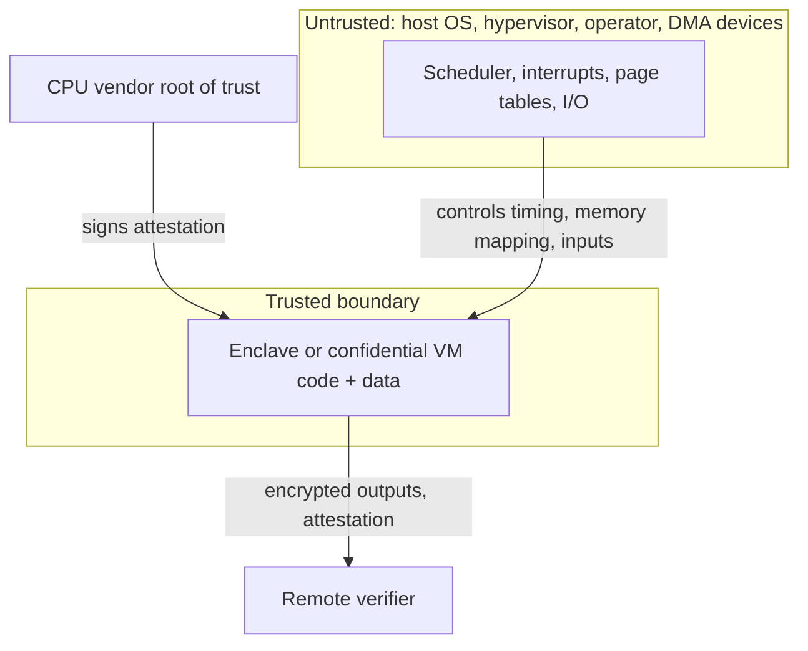

# The TEE Landscape and Its Promises

A Trusted Execution Environment (TEE) runs code isolated from the rest of the machine, including the operating system and hypervisor, and can prove to a remote party what code is running (**remote attestation**). Blockchain projects, AI inference services and key-management systems increasingly depend on TEEs. Understanding how they fail is essential before trusting them with value.

This book is defensive. Every experiment runs on hardware or cloud instances you control. Do not probe third-party TEE services, and report any weakness you find through the vendor's or project's disclosure channel.

## Families

| TEE | Isolation unit | Trust root | Notes |
|---|---|---|---|
| Intel SGX | enclave inside a process | Intel CPU keys, attestation services/DCAP | deprecated on client CPUs, still on Xeon |
| Intel TDX | confidential VM (trust domain) | Intel | runs whole guest OS |
| AMD SEV-SNP | confidential VM | AMD secure processor | widely available in clouds |
| Arm TrustZone | secure world | device vendor | phones, embedded |
| Arm CCA | realms | Arm/vendor | emerging |
| NVIDIA H100/Blackwell CC | GPU memory | NVIDIA | confidential AI |
| AWS Nitro Enclaves | isolated VM | AWS hypervisor | not a CPU TEE; trust AWS |

The families differ in *what* is inside the boundary. An SGX enclave holds a few carefully chosen functions, so its trusted computing base (TCB) is small but porting is painful. A confidential VM holds a whole Linux guest, so porting is easy but the TCB includes a kernel, a userland and every library. The second kind of TCB has far more ordinary bugs; the first kind has been attacked far more by side-channel research. Neither is "more secure" in general.

## What a TEE promises, precisely

1. **Confidentiality** of memory against a privileged host.
2. **Integrity** of code and data against the host.
3. **Attestation:** a signed measurement of the initial code/config.

What it does **not** promise:
- availability (the host can stop it at any time);
- correctness of the code inside;
- protection from all side channels (vendors explicitly exclude many);
- freshness of sealed data (rollback) unless you add it.

Read vendor threat models closely. They often state, for example, that software must be written to avoid secret-dependent memory access, or that certain physical attacks are out of scope. Those exclusions are where published attacks live.

## Who the attacker is

The TEE threat model assumes a **malicious host**: root on the OS, control of the hypervisor, the ability to interrupt, single-step, observe page faults and memory access patterns, and sometimes physical access. Most real attacks use exactly these powers.



The arrows from the host into the trusted box are the attack surface: everything the host controls about *how* the enclave runs, even though it cannot read *what* is inside.

## Worked example

> **Execution status:** Not executed in this book's CI; verify locally. Outputs described as "expected" are what the tools should show, not observed results.

Find out what TEE features your machine or cloud VM actually has, and what a guest can see. Run these on a machine you own or a VM you rented.

**Step 1: on a host, check CPU flags.**

```bash
grep -o -w -E 'sgx|sgx_lc|sev|sev_es|sev_snp|tdx_host_platform' /proc/cpuinfo | sort | uniq -c
```

Flag names depend on kernel version, so absence of a flag is not proof of absence of the feature. Check BIOS settings too; most TEEs are disabled by default.

**Step 2: inside a confidential VM, check the kernel log and devices.**

```bash
sudo dmesg | grep -i -E 'sev|tdx|memory encryption'
ls -l /dev/sev-guest /dev/tdx_guest 2>/dev/null
```

On an SEV-SNP guest you should see a line listing active memory-encryption features (SEV, SEV-ES, SEV-SNP). On a TDX guest you should see a message that a TDX guest was detected. The device node is what attestation tools use to request reports.

**Step 3: fill in a capability table** for your environment.

| Property | Your answer | How you checked |
|---|---|---|
| TEE type and generation | e.g. SEV-SNP | dmesg |
| Attestation device present | yes/no | `ls /dev/...` |
| Who controls the hypervisor | cloud provider | provider docs |
| Debug policy | must be off | attestation report (Chapter 3) |
| TCB / firmware version | from report | attestation report |

This table is the start of every review in Chapter 6.

## Common pitfalls

- **Treating "runs in a TEE" as a binary property.** The answers to "which TEE, which version, which policy, verified by whom" are what matter.
- **Confusing Nitro Enclaves or similar hypervisor isolation with CPU TEEs.** Both can be useful, but the trust root differs.
- **Assuming availability.** Designs that need the enclave to stay up to protect funds fail when the host simply stops it.
- **Forgetting the operator controls inputs.** A host that cannot read memory can still feed the enclave chosen inputs, time and network messages.
- **Ignoring the TCB size of CVMs.** A whole Linux distribution inside the boundary brings ordinary vulnerabilities with it.

## Exercises

1. For one TEE-based product you know, write down its stated threat model. What does it exclude?
2. Launch a confidential VM on a cloud provider and retrieve an attestation report.
3. List three things a malicious host can still do to a perfectly implemented TEE.
4. Compare the TCB of an SGX enclave running a signing function with a CVM running the same function in a Python service. Estimate lines of code in each.

## Further reading

- Costan & Devadas, "Intel SGX Explained", IACR ePrint 2016/086
- AMD SEV-SNP whitepaper: <https://www.amd.com/en/developer/sev.html>
- Intel TDX overview: <https://www.intel.com/content/www/us/en/developer/tools/trust-domain-extensions/overview.html>
- Confidential Computing Consortium: <https://confidentialcomputing.io>
- AWS Nitro Enclaves: <https://docs.aws.amazon.com/enclaves/>
