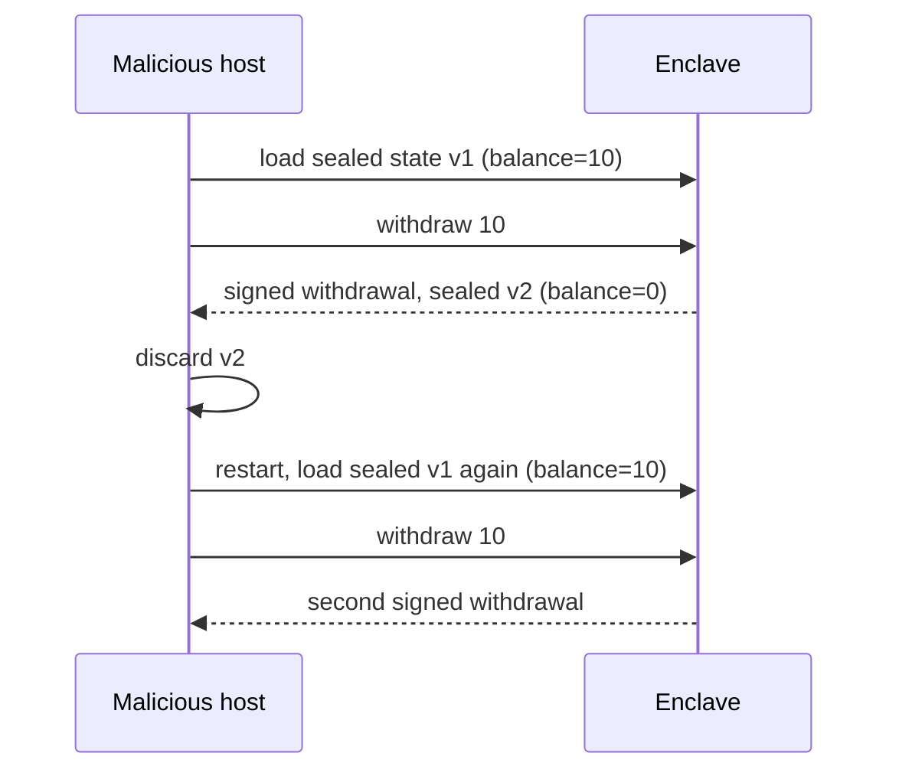

# TEE-Based Blockchains and Coprocessors

Several blockchain systems rely on TEEs for confidentiality or for off-chain computation: privacy chains such as Secret Network and Oasis Sapphire, Phala's off-chain workers, TEE-based block building and orderflow privacy (e.g. Flashbots' work on SGX/TDX builders), and TEE-secured key management for bridges and agents.

Designs in this area change quickly. Treat the project names as examples of mechanisms, and read each project's current documentation for how it handles keys, attestation and upgrades today.

## What goes wrong when TEEs secure value

1. **Shared secrets across all nodes.** If every enclave shares one master key (e.g. a network-wide decryption key), extracting it from *one* enclave breaks confidentiality for the whole history. The SGX.Fail research (2022) analysed such risks in TEE-based blockchains, including Secret Network.
2. **No forward secrecy.** Past encrypted state stays decryptable with a leaked key.
3. **Rollback and forking.** A host can restart an enclave with old sealed state, or run several copies with different inputs (a "forking attack"), unless protocol design prevents it.
4. **Attestation governance.** Who decides which measurements are valid, and how fast can a vulnerable version be revoked?
5. **Liveness:** hosts can censor or delay.

The economics differ from ordinary cloud use. In a blockchain, node operators are often anonymous and paid in tokens, so the "malicious host" in the TEE threat model is not hypothetical: it is a profit-seeking stranger with physical access and time. A side-channel attack that would be impractical against a cloud provider's tenant may be worth months of effort when one extracted key decrypts every past transaction on a chain.

| Risk | Blast radius if one enclave falls | Typical mitigation |
|---|---|---|
| Network-wide master key | all past and future state | per-epoch keys, threshold key generation |
| Per-node signing key | that node's stake or role | slashing, key rotation |
| Sealed local state | that node's view | consensus-anchored state, counters |
| Builder/orderflow key | orderflow during compromise window | short-lived keys, multiple builders |

## Rollback and forking in detail

Sealed storage encrypts data so only the same enclave on the same platform can read it. It does not record *which* version is current. A host can keep every sealed blob and feed back any old one. If the enclave enforces a rule such as "spend at most the balance" from sealed state alone, the host restores the old balance after each spend.

Forking is the parallel version: start two copies, give each a different request, and get two signatures over conflicting statements.



## Design patterns that help

- **Key rotation** and per-epoch keys, limiting the blast radius of extraction.
- **Threshold schemes across enclaves**, so one compromised TEE is not enough.
- **On-chain attestation registry** with explicit TCB policies and fast revocation.
- **Monotonic counters or consensus-anchored state** to prevent rollback.
- **Diversity**: mixing TEE vendors so one hardware bug is not systemic.

## Worked example

> **Execution status:** The Python model below was executed with Python 3 while writing this chapter; the stated output (two withdrawals, then one withdrawal and `blocked: stale state`) was observed.

Model the rollback attack in a few lines of Python, then add a consensus-anchored counter and watch the attack fail. No TEE is needed; the point is the protocol logic, which you can unit-test.

```python
import hmac, hashlib, json

SEAL_KEY = b"platform-bound-key"          # stands in for the sealing key

def seal(state):   # MAC only; real sealing also encrypts
    blob = json.dumps(state).encode()
    return blob, hmac.new(SEAL_KEY, blob, hashlib.sha256).digest()

def unseal(blob, tag):
    assert hmac.compare_digest(tag, hmac.new(SEAL_KEY, blob, hashlib.sha256).digest())
    return json.loads(blob)

class Enclave:
    def __init__(self, chain=None): self.chain = chain
    def withdraw(self, sealed, amount):
        s = unseal(*sealed)
        if self.chain is not None and s["version"] != self.chain["version"]:
            raise RuntimeError("stale state")
        assert s["balance"] >= amount
        s["balance"] -= amount; s["version"] += 1
        if self.chain is not None: self.chain["version"] = s["version"]
        return f"signed withdraw {amount}", seal(s)

v1 = seal({"balance": 10, "version": 0})
e = Enclave()
print(e.withdraw(v1, 10)[0]); print(e.withdraw(v1, 10)[0])   # rollback works

chain = {"version": 0}
e = Enclave(chain)
print(e.withdraw(v1, 10)[0])
try: e.withdraw(v1, 10)
except RuntimeError as err: print("blocked:", err)
```

Expected output: two signed withdrawals in the first case, then one withdrawal and `blocked: stale state` in the second. In a real system, `chain["version"]` is a value the enclave reads from a finalised block (with a light-client proof) or a hardware monotonic counter. Note what this does *not* fix: forking before the counter is updated on chain. The enclave must not release a signature until the new version is committed, which costs latency.

## Common pitfalls

- **One key for the whole network.** Convenient for developers, catastrophic after the first extraction.
- **Revocation by governance vote only.** If revoking a vulnerable measurement takes a week-long vote, attackers have a week.
- **Reading "the chain" from the host.** An enclave that asks the untrusted host for the latest block can be fed an old one; verify headers inside.
- **Assuming encrypted state is private forever.** Ciphertext on a public chain can be decrypted the day a key leaks.
- **Single-vendor monoculture.** One microarchitectural bug affects every node at once.

## Exercises

1. For one TEE-based chain, identify which secrets are shared across all nodes and what happens if one leaks.
2. Design a forking attack against an enclave that keeps a balance in sealed storage. Then add a defence.
3. Read the SGX.Fail paper and summarise its recommendations.
4. Extend the worked example so the enclave signs only after the new version is confirmed, and measure how many round trips this adds.

## Further reading

- SGX.Fail: <https://sgx.fail>
- Secret Network docs: <https://docs.scrt.network>
- Oasis Sapphire: <https://docs.oasis.io>
- Phala docs: <https://docs.phala.network>
- Flashbots writings on TEEs and block building: <https://writings.flashbots.net>
- Matetic et al., "ROTE: Rollback Protection for Trusted Execution", USENIX Security 2017
