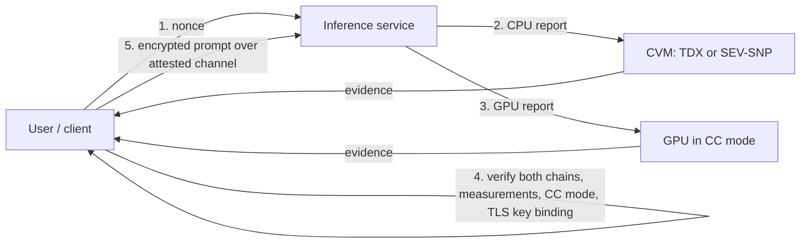

# Confidential AI and GPU TEEs

Confidential computing has moved to GPUs so that model weights and user prompts can be processed by infrastructure the user does not trust. This matters for private inference, AI agents holding secrets, and verifiable AI (see **Verifiable AI Inference**).

## How GPU confidential computing works (high level)

- The CPU side runs in a confidential VM (TDX or SEV-SNP).
- The GPU (e.g. NVIDIA H100 in CC mode) attests its firmware and mode.
- Data between CPU and GPU is encrypted over the bus via bounce buffers.
- The user verifies **both** CPU and GPU attestations before sending data.

The bounce-buffer design matters for performance. The GPU cannot read the CVM's encrypted private memory directly, so data is encrypted by the driver into a shared staging area, copied over PCIe and decrypted inside the GPU. Workloads that move a lot of data between CPU and GPU (large batches, frequent weight swaps) pay most; workloads that load weights once and stream tokens pay less. Operators measuring the overhead are tempted to switch CC mode off for "just this cluster", which is why the client must check the mode itself.



## Weak points

- **Two attestation chains** to verify correctly; skipping the GPU attestation is a common gap.
- **Performance pressure** pushes operators to disable protections.
- **Side channels** on GPUs (timing, memory access patterns) are much less studied than CPU side channels.
- **The model server** inside the TEE is large software (Python, CUDA stack). Attestation proves which image runs, not that it is free of bugs or logging.
- **Prompt injection** still works: confidentiality does not stop untrusted input from manipulating the model.
- **Channel binding:** if the TLS key that terminates your connection is not bound into the CPU attestation's report data, a proxy outside the TEE can terminate TLS, read prompts and forward them to a genuine attested backend.

## Evaluating a confidential AI service

| Question | Why |
|---|---|
| Can I verify CPU and GPU attestations myself? | otherwise you trust the operator |
| Is the serving image reproducible and published? | measurement must map to code |
| Does the image log prompts anywhere? | confidentiality ends at the logger |
| How are model weights provisioned? | key release policies tied to attestation |
| Which TCB levels are accepted? | old firmware may be vulnerable |
| Is the TLS key bound to the attestation? | otherwise a front proxy sees plaintext |
| What leaves the TEE (metrics, traces, crash dumps)? | telemetry is a side door |

## Worked example

> **Execution status:** Not executed in this book's CI; verify locally. Only the Step 3 policy function's return value is shown, and it follows directly from its inputs.

Audit a confidential-inference serving image for the two most common leaks: request logging and unbound TLS. Do this against an image you build or have permission to review.

**Step 1: find logging and telemetry in the image.**

```bash
docker create --name audit my-inference-image:tag
docker export audit | tar -x -C ./rootfs
grep -rn -E 'log(ger)?\.(info|debug)\(.*(prompt|messages|input)' ./rootfs/app | head
grep -rn -E 'OTEL_|sentry|datadog|prometheus' ./rootfs/app ./rootfs/etc 2>/dev/null | head
docker inspect my-inference-image:tag --format '{{json .Config.Env}}'
```

Hits are leads, not verdicts. Read each one. Also check the serving framework's own options: popular servers have flags that control whether request contents are logged, and defaults have changed between versions.

**Step 2: check where TLS terminates.** Inside the running CVM, list listening sockets and the process that owns each:

```bash
sudo ss -ltnp
```

If the inference server listens on plain HTTP and TLS is handled by a load balancer outside the CVM, the confidentiality claim fails regardless of attestation. The fix is to terminate TLS inside the CVM and put a hash of the TLS public key into the attestation report data.

**Step 3: write the client policy as code.** A client should refuse to send a prompt unless every check passes:

```python
def may_send(cpu_ok, gpu_ok, gpu_cc_mode_on, tls_key_bound, image_in_allowlist, tcb_ok):
    checks = dict(cpu_ok=cpu_ok, gpu_ok=gpu_ok, cc_mode=gpu_cc_mode_on,
                  tls_bound=tls_key_bound, image=image_in_allowlist, tcb=tcb_ok)
    failed = [k for k, v in checks.items() if not v]
    return (not failed, failed)

print(may_send(True, True, True, False, True, True))
# (False, ['tls_bound'])
```

Each boolean comes from a real verifier: the CPU report via your Chapter 3 code, the GPU report via NVIDIA's attestation tooling (see the `nvtrust` repository and NVIDIA's confidential computing docs). The model proposes nothing here; the policy is deterministic.

## Common pitfalls

- **Verifying only the CPU.** A GPU running outside CC mode turns the "confidential" pipeline into ordinary cloud inference.
- **Trusting a vendor-hosted attestation dashboard.** It shows what the operator chooses; verify evidence yourself.
- **Shipping debug images to production.** Debug builds often enable verbose logging and profiling hooks.
- **Forgetting outputs.** Model responses, token counts and timing can leak information about prompts.
- **Assuming confidentiality implies integrity of answers.** A confidential service can still run a different model than advertised unless the weights are measured or hashed.

## Exercises

1. Read NVIDIA's confidential computing documentation and draw the attestation flow.
2. Write the verification policy for a confidential inference endpoint.
3. Audit an open-source confidential inference image for logging of inputs.
4. Measure throughput of a small model with and without CC mode on hardware you control, and report the overhead for different batch sizes.

## Further reading

- NVIDIA confidential computing: <https://docs.nvidia.com/confidential-computing/>
- NVIDIA nvtrust (GPU attestation tools and samples): <https://github.com/NVIDIA/nvtrust>
- Confidential Computing Consortium: <https://confidentialcomputing.io>
- See **Decentralized Security Compute**, Chapter 5, in this wiki.
