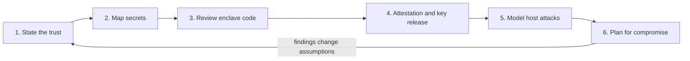

# A TEE Security Review Methodology

How to review a system that relies on a TEE. The six steps below move from trust assumptions down to code and back up to incident response. Review only systems you are authorised to assess, and send findings through the project's disclosure process.



## Step 1: State the trust

Write down, explicitly, who is trusted: CPU vendor, cloud provider, attestation service, code signers, governance that approves measurements. If the answer is "the operator", the TEE adds little.

A useful format is one line per party: *party, what they can do if malicious, why we accept it*. For example: "Cloud provider: supplies CVM firmware; could ship firmware that leaks memory; accepted because firmware measurement is pinned and the provider publishes builds." Gaps in the "why" column become findings.

## Step 2: Map secrets

For every secret (keys, user data, model weights): where is it created, which enclaves hold it, how it is sealed, how it is rotated, and what happens if one enclave leaks it.

| Secret | Created where | Held by | Sealed with | Rotation | Leak impact |
|---|---|---|---|---|---|
| Example: state key | genesis ceremony | all nodes | platform key | never | all history readable |
| Example: TLS key | per boot | one CVM | not sealed | per boot | sessions of that node |

Rows with "all nodes" and "never" deserve the most attention.

## Step 3: Review enclave code

- Constant-time handling of secrets.
- Input validation at the enclave boundary (ECALL/OCALL interfaces in SGX). Iago attacks, where a malicious OS returns crafted values to the enclave, are a classic bug class.
- Rollback protection for sealed state.
- Minimal attack surface: library OSes (Gramine, Occlum) and CVMs bring large codebases inside the boundary.

In a CVM the "boundary" includes every device the guest talks to: virtio queues, MMIO, interrupts, and the time source. The guest kernel must treat these as untrusted input, which mainline Linux has been hardening for confidential guests. Note the kernel version and configuration in your report.

## Step 4: Review attestation and key release

Use the checklist from Chapter 3. Test negative cases: debug enclave, wrong measurement, old TCB, missing nonce.

## Step 5: Model host attacks

Interrupts, single-stepping, page-fault observation, restarts, forks, delayed messages. For each, ask what the host learns or gains.

## Step 6: Plan for compromise

Assume a side channel is published tomorrow. How fast can you revoke, rotate and recover? Which past data is exposed?

## Worked example

> **Execution status:** Not executed in this book's CI; verify locally. Outputs described as "expected" are what the tools should show, not observed results.

A classic Iago-style bug, found and fixed. The example uses SGX ECALL/OCALL terminology, but the same pattern appears whenever trusted code calls out to an untrusted host and trusts the answer.

**Step 1: the vulnerable enclave code.** The enclave asks the host to read a file and return its length:

```c
// trusted (enclave) side
size_t len;
uint8_t buf[256];
ocall_read_file(&len, "config.bin", buf_untrusted);  // host fills len
memcpy(buf, buf_untrusted, len);                     // trusts host's len
```

A malicious host returns `len = 4096`, and `memcpy` overflows the enclave stack. Attestation does not help: the code is exactly what was measured.

**Step 2: the fix.**

```c
if (ocall_read_file(&len, "config.bin", buf_untrusted) != SGX_SUCCESS) abort();
if (len > sizeof buf) abort();
if (!sgx_is_outside_enclave(buf_untrusted, len)) abort();
memcpy(buf, buf_untrusted, len);
// then authenticate contents, e.g. verify a MAC or signature over buf
```

Three checks: bound the length, confirm the pointer really points outside the enclave (so the host cannot trick the enclave into copying its own secrets), and authenticate the data.

**Step 3: make the review systematic.** List every OCALL return value and out-parameter, then mark each as *bounded*, *pointer-checked* and *authenticated*. For an SGX SDK project, the EDL file lists the interface:

```bash
grep -n -E 'ocall|\[out|\[in|size=' enclave/*.edl
```

Any out-parameter without a size attribute or a later check in trusted code is a finding to verify by writing a malicious untrusted stub that returns extreme values, then exercising the trusted function with it. The simplest harness compiles the trusted function and the stub as an ordinary user-space test under AddressSanitizer; SGX simulation mode is a second option for running the real build. The checker is the sanitizer report, not your reading.

**Step 4: tabletop for Step 6.** Script the first 48 hours after a vendor advisory: who reads it, who decides whether you are affected, how the minimum TCB is raised, which keys rotate, and how users are told. Time each step with the team.

## Common pitfalls

- **Starting with code.** Without Steps 1–2, you cannot judge which code findings matter.
- **Reviewing the enclave but not the host-side helper that feeds it.** The helper decides what the enclave sees.
- **Treating simulation mode as equivalent.** It is great for functional testing and fuzzing, but provides no isolation.
- **No owner for revocation.** Plans that say "governance will decide" without names and timelines fail under pressure.
- **Reporting a side-channel risk without a threat-model link.** State which host power the attack needs and whether that power is realistic for this deployment.

## Exercises

1. Apply steps 1–6 to an open-source TEE-based project and write a two-page report.
2. Find an OCALL in an SGX application whose return value is trusted without validation.
3. Run a tabletop exercise for "TEE vendor publishes a critical advisory".
4. Write a malicious untrusted stub for one OCALL and run the trusted function against it in a user-space test built with AddressSanitizer.

## Further reading

- Checkoway & Shacham, "Iago Attacks: Why the System Call API is a Bad Untrusted RPC Interface", ASPLOS 2013
- Intel SGX SDK and EDL documentation: <https://github.com/intel/linux-sgx>
- Gramine: <https://gramine.readthedocs.io>
- Occlum: <https://github.com/occlum/occlum>
- Van Bulck et al., "A Tale of Two Worlds: Assessing the Vulnerability of Enclave Shielding Runtimes", ACM CCS 2019
